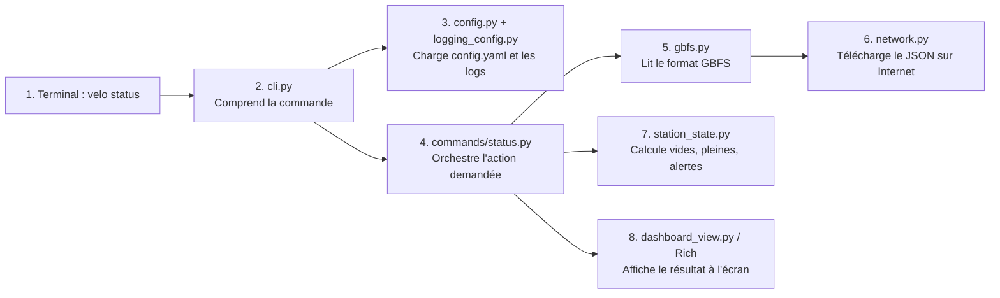

# Architecture du projet Vélo

Ce document explique simplement comment les fichiers sont rangés, comment ils communiquent entre eux et où sont enregistrées les données sur l'ordinateur.

---

## 1. Structure du dépôt

```text
VELO/
├── pyproject.toml                 # Configuration du projet (nom, bibliothèques, commande velo)
├── uv.lock                        # Versions exactes des bibliothèques (généré par uv)
├── README.md                      # Présentation générale et guide rapide
├── README_Git.md                  # Guide Git pour travailler en équipe
├── docs/                          # Toute la documentation du projet
│   ├── architecture.md            # Ce document
│   ├── commands.md                # Mode d'emploi de chaque commande
│   ├── decisions.md               # Choix techniques et règles du projet
│   └── installation.md            # Installation pas à pas
├── src/
│   └── velo/
│       ├── __init__.py            # Point de départ du package Python
│       ├── cli.py                 # Lit la commande tapée dans le terminal (argparse)
│       ├── models.py              # Définit les "moules" de données (Station, Relevé, Erreurs)
│       ├── logging_config.py      # Enregistre les messages de suivi dans velo.log
│       ├── config.py              # Lit et vérifie le fichier config.yaml
│       ├── network.py             # Télécharge les fichiers JSON sur Internet
│       ├── gbfs.py                # Traduit les fichiers GBFS en objets Python simples
│       ├── station_state.py       # Calcule si une station est vide, pleine ou hors service
│       ├── commands/              # Un fichier par commande disponible dans le terminal
│       │   ├── init.py            # velo init
│       │   ├── refresh.py         # velo refresh
│       │   ├── status.py          # velo status
│       │   ├── station.py         # velo station
│       │   ├── favorites.py       # velo favorites
│       │   ├── alerts.py          # velo alerts
│       │   ├── dashboard.py       # velo dashboard
│       │   ├── collect.py         # velo collect
│       │   ├── history.py         # velo history
│       │   └── query.py           # velo query
│       ├── dashboard/
│       │   └── dashboard_view.py  # Dessine le tableau de bord dans le terminal (Rich)
│       ├── collection/
│       │   ├── storage.py         # Écrit et lit les fichiers CSV d'historique
│       │   └── collector.py       # Boucle automatique qui enregistre les relevés
│       └── analysis/
│           ├── metrics.py         # Calcule les moyennes et pourcentages (empty_rate...)
│           └── analysis.py        # Filtre et trie l'historique pour velo query
└── tests/                         # Tests automatiques (pytest) sans appel Internet réel
```

---

## 2. Comment les modules travaillent ensemble

Quand l'utilisateur tape une commande dans le terminal (par exemple `velo status` ou `velo query`), les fichiers s'appellent dans un ordre précis pour séparer les rôles :



### Explication étape par étape

1. **Entrée (`cli.py`)** : C'est la porte d'entrée. Il lit ce que l'utilisateur a tapé (`status`, `alerts`, `--low-bikes 5`, etc.) grâce à `argparse`.
2. **Configuration (`config.py` et `logging_config.py`)** : Avant de lancer la commande (sauf pour `velo init`), le programme vérifie que `config.yaml` est valide et prépare le fichier de journalisation `velo.log`.
3. **Chef d'orchestre (`commands/*.py`)** : Chaque commande a son propre petit fichier (ex. `commands/status.py`). Il demande les données nécessaires, appelle les fonctions de calcul puis affiche la réponse.
4. **Réseau et traduction GBFS (`network.py` -> `gbfs.py` -> `models.py`)** :
   - `network.py` va chercher le texte JSON brut sur Internet (et renvoie un message simple si le Wi-Fi est coupé).
   - `gbfs.py` est **le seul fichier** qui connaît la structure du standard GBFS. Il lit `gbfs.json` pour trouver les autres liens, puis transforme les données brutes en objets simples définis dans `models.py` (`StationInfo`, `StationStatus`).
   - Résultat : le reste du programme n'a pas besoin de savoir comment l'API GBFS est fabriquée.
5. **Calculs métier (`station_state.py`, `collection/`, `analysis/`)** :
   - `station_state.py` décide si une station est hors service, vide ou pleine, et fait la recherche par texte.
   - `collection/` enregistre les relevés dans des fichiers CSV quotidiens (`storage.py`) à intervalle régulier (`collector.py`).
   - `analysis/` calcule les moyennes et taux sur l'historique (`metrics.py`) après filtrage (`analysis.py`).
6. **Affichage (`dashboard_view.py` et `Rich`)** : L'affichage est séparé des calculs. Par exemple, `dashboard_view.py` reçoit des résultats déjà calculés et se contente de les dessiner proprement dans le terminal.

---

## 3. Arborescence des données utilisateur

Par défaut (modifiable dans `config.yaml` ou via les variables `VELO_CONFIG` et `VELO_DATA_DIR`) :

```text
~/.config/velo/
└── config.yaml                    # Réglages du projet (réseau, seuils, intervalles)

~/.local/share/velo/
├── velo.log                       # Journal des événements et erreurs (UTF-8)
└── vlille/                        # Un dossier par réseau configuré
    ├── system_information.json    # Copie locale des infos du réseau
    ├── station_information.json   # Copie locale de la liste des stations
    ├── vehicle_types.json         # Copie locale des types de vélos
    ├── favorites.json             # Jusqu'à 10 identifiants de stations favorites
    └── history/                   # Historique collecté au format CSV
        ├── 2026-11-18.csv
        └── 2026-11-19.csv
```
