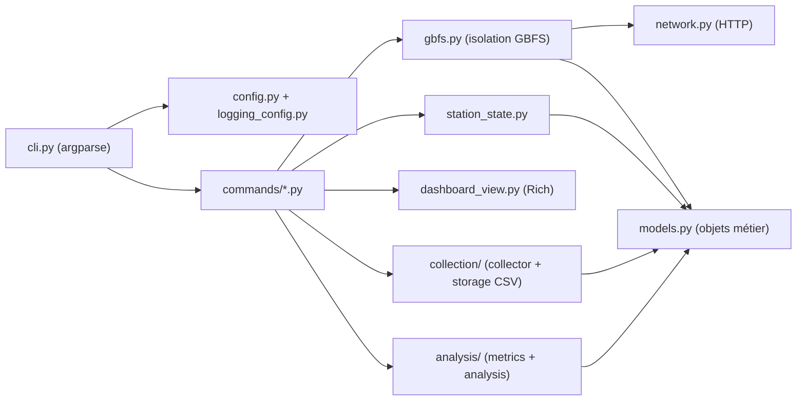

# Architecture du projet Vélo

Ce document décrit l'organisation des dossiers, le rôle de chaque module Python et le stockage des données locales.

---

## 1. Structure du dépôt

```text
VELO/
├── pyproject.toml                 # Configuration du paquet, dépendances, scripts, pytest et ruff
├── uv.lock                        # Verrouillage des dépendances uv
├── README.md                      # Présentation générale et guide rapide
├── README_Git.md                  # Guide de workflow Git pour l'équipe
├── docs/                          # Documentation complète du projet
│   ├── architecture.md            # Ce document
│   ├── commands.md                # Manuel détaillé de chaque commande CLI
│   ├── decisions.md               # Justifications techniques et règles métier
│   └── installation.md            # Installation pas à pas (de uv au premier lancement)
├── src/
│   └── velo/
│       ├── __init__.py            # Expose main()
│       ├── cli.py                 # Analyse argparse et point d'entrée `velo`
│       ├── models.py              # Dataclasses métier et hiérarchie VeloError
│       ├── logging_config.py      # Configuration du module logging (console + fichier)
│       ├── config.py              # Lecture, validation YAML et règle de priorité
│       ├── network.py             # Requêtes HTTP avec requests et gestion d'erreurs
│       ├── gbfs.py                # Seul module connaissant le format GBFS (v2 et v3)
│       ├── station_state.py       # États des stations, stats réseau, alertes, regex
│       ├── commands/              # Implémentation des sous-commandes CLI
│       │   ├── init.py
│       │   ├── refresh.py
│       │   ├── status.py
│       │   ├── station.py
│       │   ├── favorites.py
│       │   ├── alerts.py
│       │   ├── dashboard.py
│       │   ├── collect.py
│       │   ├── history.py
│       │   └── query.py
│       ├── dashboard/
│       │   └── dashboard_view.py  # Rendu Rich du tableau de bord temps réel
│       ├── collection/
│       │   ├── storage.py         # Lecture/écriture CSV quotidiens et détection de périodes
│       │   └── collector.py       # Boucle périodique de collecte et déduplication
│       └── analysis/
│           ├── metrics.py         # Calculs avg_bikes, avg_docks, empty_rate, full_rate
│           └── analysis.py        # Filtres, regroupements, classements et interruptions
└── tests/                         # Suite de tests pytest (appels API simulés)
```

---

## 2. Flux de données entre modules



---

## 3. Arborescence des données utilisateur

Par défaut (surchargeable via `VELO_CONFIG` et `VELO_DATA_DIR`, ou `data.folder` dans `config.yaml`) :

```text
~/.config/velo/
└── config.yaml                    # Configuration YAML éditable par l'utilisateur

~/.local/share/velo/
├── velo.log                       # Journal d'exécution UTF-8 (module logging)
└── vlille/                        # Un sous-dossier par réseau (slugifié)
    ├── system_information.json    # Copie locale des infos réseau
    ├── station_information.json   # Copie locale de la liste des stations
    ├── vehicle_types.json         # Copie locale des types de vélos
    ├── favorites.json             # Jusqu'à 10 identifiants de stations favorites
    └── history/                   # Historique collecté au format CSV
        ├── 2026-11-18.csv
        └── 2026-11-19.csv
```

